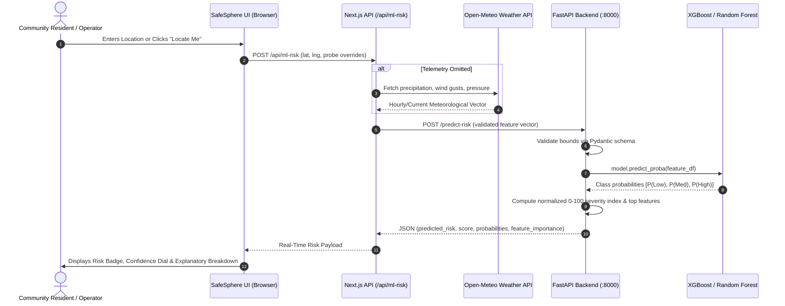
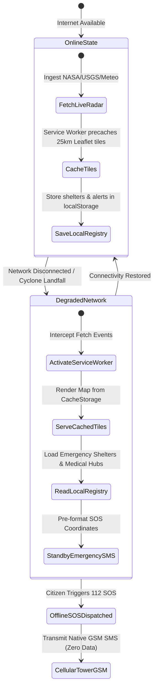

# SafeSphere AI — System Architecture & Technical Specification

This document details the multi-tier engineering architecture, data ingestion pipelines, machine learning inference engines, zero-grid offline failover systems, and remote deployment topology of **SafeSphere AI**.

---

## 1. High-Level Architecture Topology

```mermaid
flowchart TD
    subgraph External_Sensors["External Telemetry & Sensor Feeds"]
        NASA["NASA EONET API<br/>(Tropical Cyclones, Wildfires, Storms)"]
        USGS["USGS Real-Time Seismic API<br/>(Earthquake Clusters & Magnitudes)"]
        METEO["Open-Meteo Weather API<br/>(Precipitation, Wind Gusts, Pressure)"]
        OVERPASS["OpenStreetMap Overpass API<br/>(Relief Shelters & Trauma Centers)"]
        OSRM["OSRM Routing Engine<br/>(Road Network Graph)"]
    end

    subgraph Client_Tier["Client Tier (Browser & PWA)"]
        UI["SafeSphere AI Web App<br/>(Next.js 16 + React 19 + Tailwind CSS)"]
        MAP["Leaflet Geospatial Canvas<br/>(OpenStreetMap Dark Tiles)"]
        ML_UI["ML Inference & Comparison Panel<br/>(RF vs XGBoost Dynamic Probe)"]
        SW["Service Worker (sw.js)<br/>(Offline CacheStorage & Telemetry)"]
        SMS["GSM SMS Fallback Engine<br/>(Zero-Grid 112 Dispatch)"]
    end

    subgraph NextJS_Fullstack["Next.js Server-Side Tier (Node.js)"]
        PROXY["Proxy & Security Layer<br/>(middleware.ts / proxy)"]
        API_DISASTERS["/api/disasters<br/>(NASA & USGS Ingestion + Buffer Polygons)"]
        API_ML["/api/ml-risk<br/>(FastAPI ML Proxy & Telemetry Enrichment)"]
        API_ROUTES["/api/routes<br/>(Hazard Avoidance Pathfinding)"]
        API_SHELTERS["/api/shelters<br/>(Geo-Sorted Relief Facilities)"]
        API_TRANSLATE["/api/translate<br/>(Claude AI / Multilingual Engine)"]
    end

    subgraph ML_Backend["Python Machine Learning Backend (FastAPI :8000)"]
        FASTAPI["FastAPI REST Server<br/>(Uvicorn ASGI)"]
        VALIDATOR["Pydantic Input Validator<br/>(Physical Limits & Sanity Checks)"]
        RF_MODEL["RandomForestClassifier<br/>(100 Trees, Balanced Bagging)"]
        XGB_MODEL["XGBClassifier<br/>(Gradient Boosted Trees, multi:softprob)"]
        ARTIFACTS["Model Artifacts (.joblib)<br/>(rf_model, xgb_model, metadata)"]
    end

    subgraph Cloud_Remote["Cloud & Remote Infrastructure"]
        GITHUB["GitHub Repository<br/>(pradeepsankar77/safesphereai)"]
        VERCEL["Vercel Cloud Edge<br/>(Serverless Frontend & API Routes)"]
        SUPABASE["Supabase Cloud<br/>(PostgreSQL + RLS + Auth Sessions)"]
    end

    %% Feed Ingestion
    NASA --> API_DISASTERS
    USGS --> API_DISASTERS
    METEO --> API_ML
    OVERPASS --> API_SHELTERS
    OSRM --> API_ROUTES

    %% Client / Server Communication
    UI <--> PROXY
    PROXY --> API_DISASTERS
    PROXY --> API_ML
    PROXY --> API_ROUTES
    PROXY --> API_SHELTERS
    PROXY --> API_TRANSLATE

    %% ML Flow
    API_ML <-->|HTTP JSON REST| FASTAPI
    FASTAPI --> VALIDATOR
    VALIDATOR --> RF_MODEL
    VALIDATOR --> XGB_MODEL
    ARTIFACTS -.->|joblib.load| FASTAPI

    %% UI Components
    UI --- MAP
    UI --- ML_UI
    UI --- SW
    SW --- SMS

    %% Cloud Linkage
    GITHUB -->|Automated CI/CD| VERCEL
    PROXY -.->|Session Token| SUPABASE
```



---

## 2. Ingestion & Risk Inference Data Pipeline

The sequence below illustrates how live meteorological telemetry and geographic disaster buffers are fused to produce real-time machine learning risk classifications:



---

## 3. Zero-Grid Offline Failover Architecture

SafeSphere AI operates continuously even when cellular data towers or power grids are compromised:



---

## 4. Layer-by-Layer Architectural Breakdown

### 4.1 Ingestion Layer (Sensor Aggregation)
- **NASA EONET (Earth Observatory Natural Event Tracker)**: Pulls active tropical cyclones, volcanic activity, and wildfires.
- **USGS Earthquake Feeds**: Streams sub-minute seismic magnitude, focal depth, and epicenter coordinates.
- **Open-Meteo Historical & Forecast API**: Provides calibrated ECMWF ERA5 reanalysis and 72-hour precipitation, barometric surface pressure, and peak wind gusts.
- **OpenStreetMap Overpass API**: Discovers operating civil defense centers, relief camps, and trauma hospitals within a 25 km radius.
- **OSRM (Open Source Routing Machine)**: Computes driving and walking trajectories dynamically avoiding hazard perimeter buffer polygons.

### 4.2 Fullstack Web Layer (Next.js 16 App Router)
- **Framework**: Next.js 16.4.0 with Turbopack compilation engine.
- **UI Framework**: React 19, Tailwind CSS v4, Lucide React iconography.
- **Geospatial Mapping**: React-Leaflet with OpenStreetMap tiles and custom high-contrast dark filter to prevent API key dependency.
- **API Proxies**:
  - `/api/disasters`: Synthesizes NASA and USGS telemetry with automatic 5 km safety buffer calculations.
  - `/api/ml-risk`: Enriches coordinate requests with live weather and forwards to FastAPI ML service.
  - `/api/shelters`: Live shelter discovery with distance sorting.
  - `/api/routes`: Generates safe evacuation paths around disaster perimeters.
  - `/api/translate`: Multilingual emergency translation using Claude AI with verified fallback strings.

### 4.3 Machine Learning Inference Tier (Python & FastAPI)
- **API Runtime**: FastAPI with Uvicorn ASGI server running on port 8000.
- **Algorithms**:
  - `RandomForestClassifier`: 100 decision trees, balanced bagging, `max_depth=8`.
  - `XGBClassifier`: Gradient-boosted decision trees, `learning_rate=0.08`, `objective='multi:softprob'`, `eval_metric='mlogloss'`.
- **Validation Metrics (Held-Out Test Set)**:
  - XGBoost: **93.15% Accuracy**, **0.9012 Macro F1** (Selected as Preferred Model).
  - Random Forest: **91.78% Accuracy**, **0.8894 Macro F1**.
- **Model Serialization**: `joblib` artifacts persisted in `ml_backend/artifacts/`.

### 4.4 Data Protection & Authentication Layer
- **Supabase**: PostgreSQL database with Row-Level Security (RLS) enabled.
- **Session Management**: Handled via `@supabase/ssr` cookies inside `middleware.ts`.

---

## 5. Remote Access & Cloud Deployment Topology

```
+-------------------------------------------------------------------------+
|                              INTERNET                                   |
+-------------------------------------------------------------------------+
                                    |
            +-----------------------+-----------------------+
            |                                               |
            v                                               v
+-----------------------+                       +-----------------------+
|     Vercel Cloud      |                       |    ML Backend Host    |
|   (Next.js Frontend)  |                       |   (FastAPI :8000)     |
|                       |                       |                       |
|  - Turbopack SSR      |                       |  - Uvicorn Server     |
|  - Edge Middleware    |                       |  - Scikit-Learn / XGB |
|  - Static CDN Assets  |                       |  - Model Artifacts    |
+-----------------------+                       +-----------------------+
            |                                               ^
            |                                               |
            +------- Proxy (/api/ml-risk via CORS) ---------+
```

1. **Frontend Deployment**: Automated CI/CD deployment on **Vercel** connected directly to the GitHub repository `pradeepsankar77/safesphereai`.
2. **Backend Deployment**: The FastAPI service can be hosted on any cloud container (Railway, Render, AWS ECS, or DigitalOcean) and linked via the `ML_BACKEND_URL` environment variable.
3. **CORS Configuration**: FastAPI includes `CORSMiddleware` configured to accept cross-origin requests from the Vercel production domain and local development instances.
