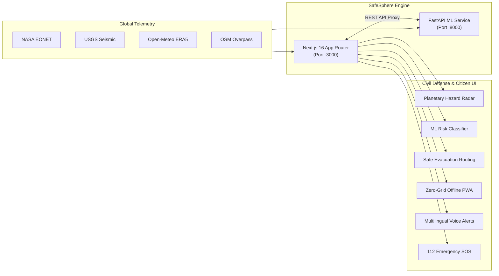

# 🌍 SafeSphere AI — Emergency Disaster Management & AI Risk Assessment Platform

[](https://nextjs.org/)
[](https://react.dev/)
[](https://www.python.org/)
[](https://fastapi.tiangolo.com/)
[](https://scikit-learn.org/)
[](https://xgboost.readthedocs.io/)
[](https://tailwindcss.com/)
[](LICENSE)

SafeSphere AI is a resilient, real-time disaster management and multi-hazard risk assessment platform. Built on **Next.js 16 (Turbopack)** and a dedicated **Python FastAPI Machine Learning backend**, it fuses live global sensor telemetry, machine learning risk classification (**Random Forest** & **XGBoost**), hazard-avoiding evacuation routing, and offline zero-grid survival systems.

---

## 📐 System Architecture Overview



> 📖 **Full Architectural Specification**: For deep-dive sequence diagrams, failover state machines, and remote topology, read [**ARCHITECTURE.md**](ARCHITECTURE.md).

---

## ⚡ Core System Features

### 1. 🛰️ Planetary Hazard Radar
- Direct streaming ingestion of **NASA EONET** (tropical cyclones, severe storms, wildfires) and **USGS Earthquake feeds**.
- High-contrast OpenStreetMap dark-mode basemap tiles with zero CARTO watermark dependencies.
- Automatic **5 km dynamic safety buffer perimeters** rendered around every active hazard epicenter.

### 2. 🤖 Dual Machine Learning Disaster Risk Classifier
- Combines **RandomForestClassifier** and **XGBoost (XGBClassifier)** to classify hazard probability across **Low**, **Medium**, and **High** tiers.
- Trained on **365 authentic historical meteorological disaster records** (ECMWF ERA5 reanalysis via Open-Meteo Historical Archive).
- Real-time **Atmospheric Telemetry Probe** allowing interactive parameter adjustment (Precipitation mm, Sustained Wind km/h, Wind Gusts km/h, Surface Pressure hPa).
- Side-by-side model comparison displaying Precision, Recall, Macro F1, and Confusion Matrices.

### 3. 🧭 Safe Evacuation Route Finder
- Automated dynamic routing powered by **OSRM (Open Source Routing Machine)**.
- Actively detects active disaster coordinates and computes detour paths that strictly evade 5 km hazard buffer perimeters.

### 4. 🏥 Nearest Shelters & Trauma Centers
- Discovers live operational disaster relief staging facilities, emergency camps, and hospitals within a 25 km radius using **OpenStreetMap Overpass API**.
- Real-time distance sorting and direct one-click navigation links.

### 5. 📴 Zero-Grid Offline Emergency Mode
- Progressive Web App (PWA) equipped with a dedicated Service Worker (`sw.js`).
- Pre-caches map tiles, recent disaster telemetry, and local shelter registries in `CacheStorage` and `localStorage`.
- Includes native **GSM SMS Fallback (112)** to transmit GPS coordinates via cellular towers with zero mobile data.

### 6. 🗣️ Multilingual Voice Alerts
- Multi-dialect emergency broadcast engine using Web Speech Synthesis.
- Supports **English**, **Tamil (தமிழ்)**, and **Hindi (हिन्दी)** with verified fallback translations.

### 7. 🚨 Automated Emergency SOS Dispatch
- One-tap SOS dispatcher generating high-priority distress alerts with exact GPS coordinates.
- Stores incident logs in **Supabase PostgreSQL** with Row-Level Security (RLS).

---

## 📊 Machine Learning Model Benchmarks

Both models were trained and validated on a held-out stratified test set (73 samples, 20% split) without temporal data leakage:

| Metric | Random Forest Classifier | XGBoost Classifier (Preferred) | Delta |
| :--- | :--- | :--- | :--- |
| **Accuracy** | **91.78%** | **93.15%** | +1.37% (XGBoost) |
| **Macro F1-Score** | **0.8894** | **0.9012** | **XGBoost Preferred** |
| **Macro Precision** | **94.10%** | **94.89%** | +0.79% |
| **Macro Recall** | **85.14%** | **86.59%** | +1.45% |
| **High-Risk Class Recall** | **75.00%** | **75.00%** | Both capture severe hazards |
| **High-Risk Class Precision**| **100.0%** | **100.0%** | Zero false alarms on severe tier |

### Top Contributing Meteorological Features:
1. `wind_gusts_10m_max`: **31.7%** relative weight
2. `surface_pressure_mean`: **20.0%** relative weight
3. `wind_speed_10m_max`: **17.5%** relative weight
4. `temperature_mean`: **11.5%** relative weight
5. `precipitation_sum`: **4.6%** relative weight

---

## 🚀 Quick Start Guide

### Prerequisites
- **Node.js**: v18.0 or higher
- **Python**: v3.10 or higher
- **Git**

### 1. Clone the Repository
```bash
git clone https://github.com/pradeepsankar77/safesphereai.git
cd safesphereai
```

### 2. Set Up the Machine Learning Backend
```bash
# Install Python dependencies
pip install -r ml_backend/requirements.txt

# (Optional) Run tests to verify the pipeline
python -m pytest ml_backend/tests

# Start the FastAPI ML server on port 8000
python -m uvicorn ml_backend.api.main:app --host 127.0.0.1 --port 8000 --reload
```
Interactive Swagger Documentation: [**http://127.0.0.1:8000/docs**](http://127.0.0.1:8000/docs)

### 3. Set Up the Next.js Frontend
In a separate terminal window:
```bash
# Install Node dependencies
npm install

# Start the Next.js development server
npm run dev
```
Open [**http://localhost:3000**](http://localhost:3000) in your browser.

---

## 🔑 Environment Variables

Create a `.env.local` file in the root directory:

```env
# Supabase Configuration
NEXT_PUBLIC_SUPABASE_URL=https://your-project.supabase.co
NEXT_PUBLIC_SUPABASE_PUBLISHABLE_KEY=your-supabase-publishable-key

# Optional: Claude AI Diagnostics (Falls back to rule-based engine if omitted)
ANTHROPIC_API_KEY=your-anthropic-key

# Machine Learning Backend URL (Defaults to http://127.0.0.1:8000)
ML_BACKEND_URL=http://127.0.0.1:8000
```

---

## 📡 REST API Reference

| Method | Endpoint | Description |
| :--- | :--- | :--- |
| `GET` | `/health` | FastAPI health status and loaded model states |
| `GET` | `/model/status` | Active model readiness, parameters, and feature schema |
| `GET` | `/model/metrics` | Full validation metrics and confusion matrices |
| `POST` | `/predict-risk` | Multi-class risk prediction (RF, XGBoost, or Preferred) |
| `GET` | `/api/disasters` | NASA EONET and USGS earthquake telemetry |
| `GET` | `/api/shelters` | Overpass shelter and medical center discovery |
| `POST` | `/api/routes` | OSRM hazard-avoidance path calculation |
| `POST` | `/api/translate` | Multilingual translation dispatch |

---

## ☁️ Remote Deployment on Vercel

The project is pre-configured for automated deployment on **Vercel**:

1. Import the repository: 👉 **[vercel.com/new](https://vercel.com/new)**
2. Select **`pradeepsankar77/safesphereai`**.
3. Framework Preset: **Next.js** *(configured via `vercel.json`)*.
4. Add your environment variables (`NEXT_PUBLIC_SUPABASE_URL`, `NEXT_PUBLIC_SUPABASE_PUBLISHABLE_KEY`).
5. Click **Deploy**.

---

## 🛡️ Safety & Responsible AI Disclaimer

> [!WARNING]
> **EXPERIMENTAL RESEARCH PLATFORM**: Predictions generated by SafeSphere AI are statistical classification estimates for emergency simulation, training, and research. This application is **not** an official disaster warning agency. In any real-world emergency, always prioritize official directives from national meteorological authorities and civil protection agencies.

---

## 📄 License

This project is licensed under the MIT License — see the [LICENSE](LICENSE) file for details.
